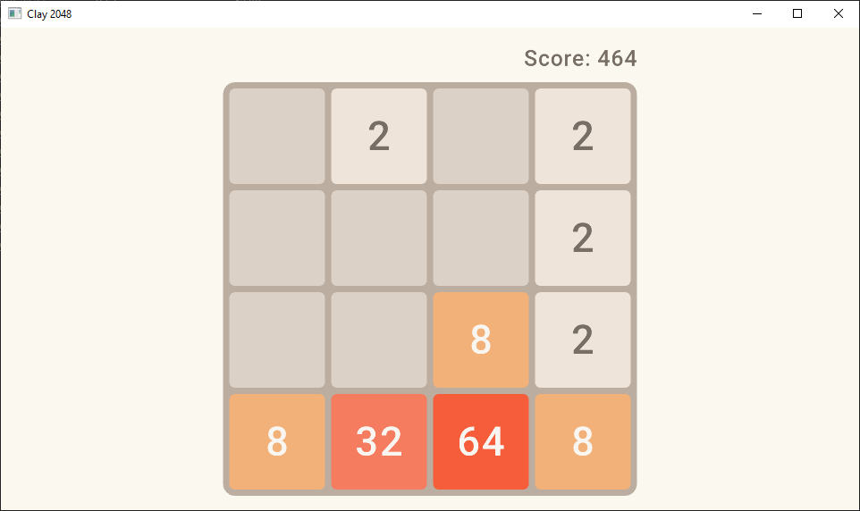
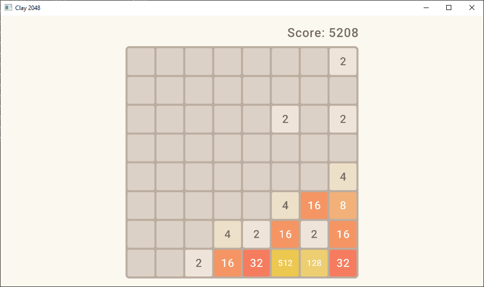

# clay-2048

Game of 2048 reimplemented in C, using Clay library with Raylib renderer. Tried to capture the look and feel of the original. The board and initial spawn tile count is tweakable. Maybe some other things will be too, in the future.

Controls:
- Arrows/WASD
- Ctrl + R to reset board
- ESC to show settings screen

